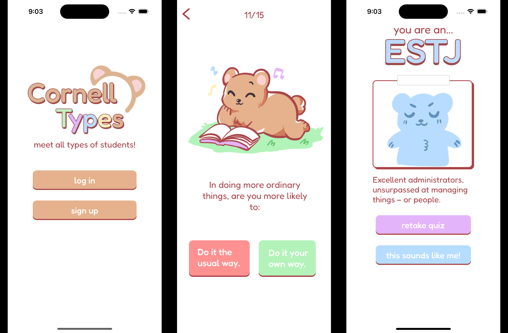
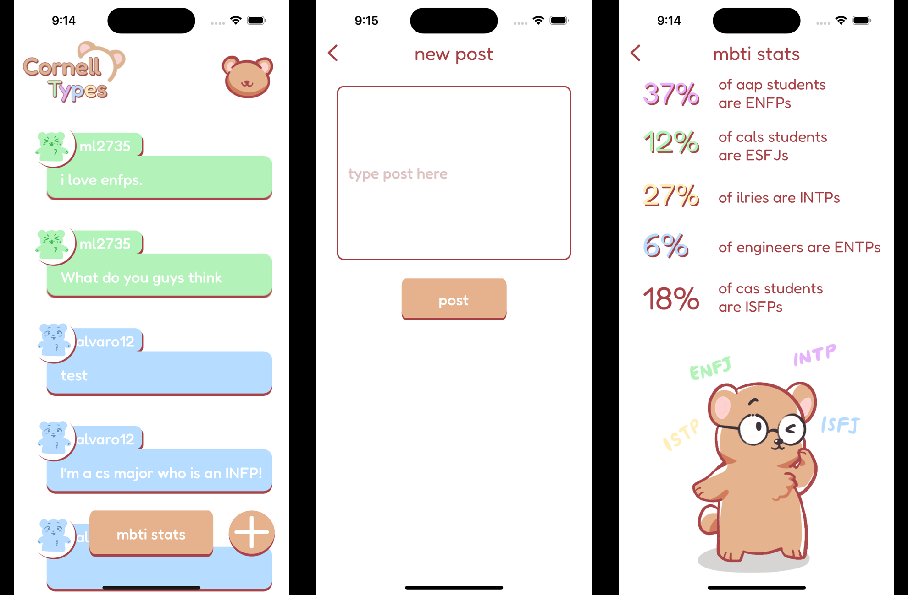

Cornell Types is an iOS app where Cornell students find their Myers-Briggs personality type and share it with the rest of campus. Six of us built it for Cornell AppDev's Fall 2023 Hack Challenge: three on the iOS app, two on the backend, and one designer. I worked on the iOS app with Alvaro Deras and David Lee.

## What it does

You sign up with your Cornell email, verify it with a code, and pick your college. If you already know your type you can enter it. Otherwise the app walks you through a fifteen-question quiz and tells you what you are, with a short description and a bear to match. Every one of the sixteen types has its own bear, drawn by our designer, Shihan Gao.

Once you have a type you land on a shared feed, where posts are colored by the author's type, and you can write your own. A stats page shows how types break down across Cornell's colleges, and each user has a profile with their type and a bio.

## How it is built

The app is written in Swift with UIKit. It talks to the team's backend over a REST API using Alamofire, through a single networking layer that covers registration, email verification, the quiz, posts, and profiles. The [backend](https://github.com/tg329/cornell-types/tree/backend) was written by Hannah Zhou and Lakshmi Meghana Kesanapalli.

This was my first iOS app and my first time shipping something with a designer and a separate backend team, on a deadline. Most of what I learned was about agreeing on an API early and building screens against it before it existed.
