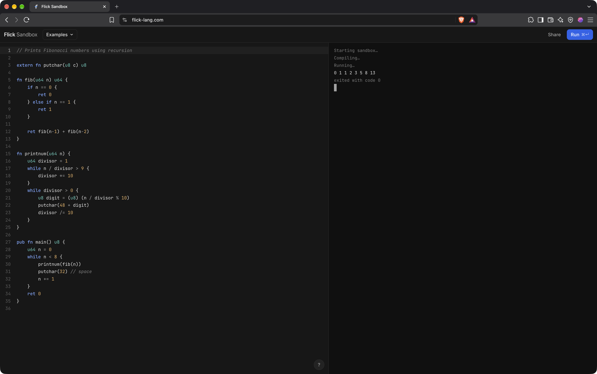

Flick is a programming language that [Thomas Breydo](https://www.thomasbreydo.com/) and I started in April 2022 because we wanted to understand how compilers actually work. Reading about lexers and parsers only gets you so far, so we wrote our own language from scratch: the syntax, the type system, and a compiler in Rust that turns Flick source into a native executable. You can try it in the browser at [flick-lang.com](https://flick-lang.com/), and the compiler is open source at [github.com/flick-lang/flick](https://github.com/flick-lang/flick).



## The language

Flick borrows its look from Rust, with a few choices of our own. Types come before names, statements end at the newline rather than a semicolon, and `ret` returns a value. It is statically typed with type inference, and integers can be any width, so `u8`, `i64`, and `i11` are all valid types. Functions can be called before they are defined, and `extern` declarations let a Flick program call into C, which is how the example below prints characters with `putchar`.

```rust
extern fn putchar(u8 c) u8

fn fib(u64 n) u64 {
    if n == 0 {
        ret 0
    } else if n == 1 {
        ret 1
    }

    ret fib(n-1) + fib(n-2)
}
```

The language is deliberately small. It has functions, variables, integer arithmetic, comparisons, `if`/`else`, and `while` loops. That is enough to be Turing-complete and enough to write real programs like factorial, Fibonacci, and a routine that prints a number digit by digit, while keeping the whole compiler readable.

## The compiler

The lexer walks the source text and produces tokens. A hand-written recursive-descent parser turns those tokens into an abstract syntax tree. The typer then walks the tree with a scope manager that tracks which names are visible where, checks every expression, rejects mismatched types and undefined identifiers, and produces a second, fully typed tree. It registers every function signature before it looks at any function body, which is what allows calls to functions defined later in the file.

The last stage walks the typed tree and emits LLVM IR. LLVM handles optimization and code generation for the target machine and writes an object file, and the compiler finishes by invoking a linker to produce an executable. Passing `--emit-ir` prints the generated IR, which was the single most useful debugging tool we had.

Splitting typing from code generation was the best structural decision in the project. Early versions tried to check types while emitting IR, and every new feature made that code harder to reason about. Once the typer produced its own tree, the code generator could assume its input was correct and became much simpler.

## The sandbox

Running a stranger's code is the interesting part. Flick's `extern` declarations can call any C library function, so running someone's program is the same as handing them a shell. When we first built the sandbox in 2024, that meant hosting it ourselves: a Next.js frontend opened a WebSocket to a FastAPI backend on AWS EC2, which compiled each program in a Docker container with no network access, killed it after five seconds, and streamed the output back. It worked, but keeping that server patched and those containers locked down was our job, and a container shares its kernel with the host it runs on.

Since then, Vercel and Cloudflare have both started offering sandboxes that run each workload in its own microVM, so we handed the isolation to them and shut down the EC2 server. The site is now an Astro app on Vercel. The first time you press Run, a single server endpoint creates a [Vercel Sandbox](https://vercel.com/docs/vercel-sandbox), a Firecracker microVM started from an image with the compiler in it, with no network access, one vCPU, and a two-minute limit. The browser then connects straight to the sandbox's terminal over a WebSocket, so our server never sits between the program and its output. Later runs in the same tab reuse the sandbox and start immediately, and it is deleted two minutes after the last one.

The page itself got smaller too. We replaced the Monaco editor with CodeMirror, which is far lighter and is all a single-file playground needs. The console is now a real terminal built on xterm.js and connected to the program in both directions, so ANSI colors render properly and you can type into a running program, which the old output-only console could not do. The guessing game example on the site uses this: think of a number from 1 to 100 and answer each guess with higher or lower until it finds it.

## What I took from it

Flick is where I first had to think about a program as a series of representations rather than a single piece of logic. It also changed how I read compiler errors: having written the code that produces them, I now have a much better idea of what the compiler knew at the point where it gave up.
