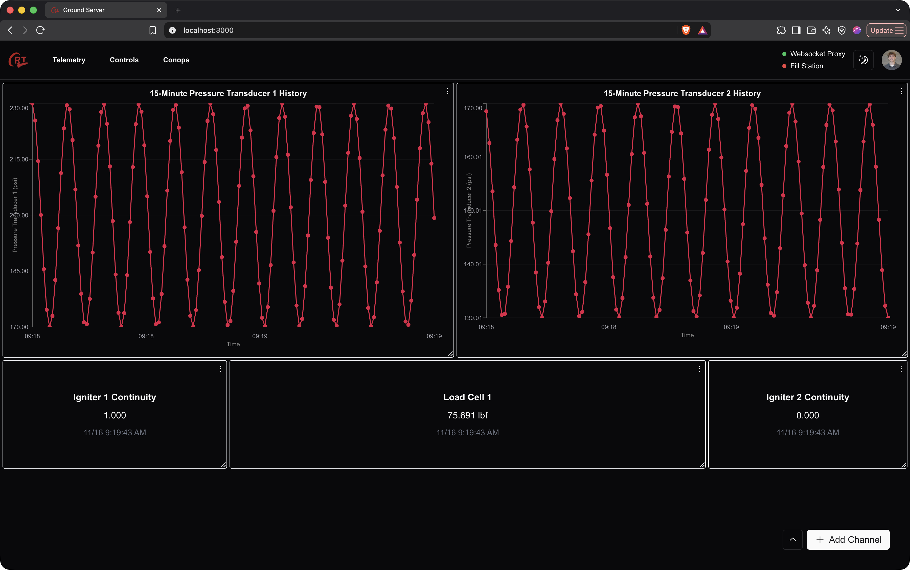
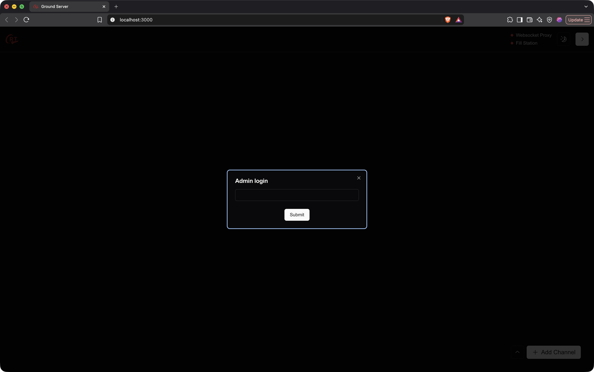
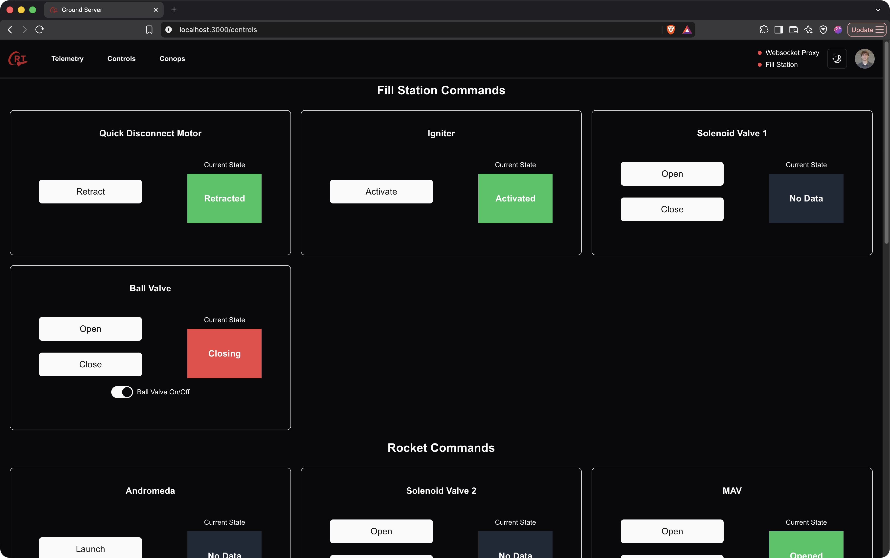
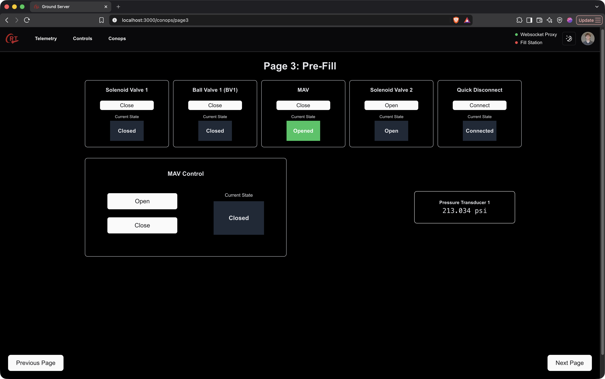

<video autoplay muted loop playsinline poster="/videos/ground-software.jpg" src="/videos/ground-software.mp4" aria-label="Drone and pad camera footage of a cold flow test in the snow, next to the telemetry dashboard showing tank pressure dropping as the main valve opens"></video>

*A cold flow test in February 2025: drone and pad cameras next to the live dashboard as the main valve opens and tank pressure falls.*

As a sophomore on Cornell Rocketry's software subteam, I built the interface our team used on the ground: one web app for watching telemetry, commanding the rocket and the fill station, and walking through launch procedures. We used it to fill and launch our rocket at the Intercollegiate Rocket Engineering Competition in June 2025.

The goal was a single screen that anyone on the team could open in a browser, where the people who needed to send commands could do so safely and everyone else could watch.

## Telemetry

The home page is a dashboard you build yourself. Every value the rocket and fill station report, about 75 channels in all, can be added as a widget, dragged into place, and resized. A pressure transducer can be a single large number for the person calling the fill, or a graph of the last minute, fifteen minutes, or hour for the person looking for a leak. The layout is saved in the browser, so each operator's station comes back the way they left it.

Data reaches the browser over a WebSocket. Go services on the ground computer ingest telemetry from the fill station and the rocket's radio link and write it to InfluxDB, and a third service streams live values to every connected browser and answers requests for history. The page only subscribes to the fields that are actually on screen, which kept the dashboard responsive on the laptops we had in the field.

## Keeping commands behind the server

Anyone on the network could open the dashboard, and that was intended. Sending a command to a fuelled rocket needed to be a different matter, so the controls and conops pages sit behind an operator password.

The app uses Next.js Server Actions for this. The function that sends a command runs only on the server, and the first thing it does is check for a valid session, so the browser never talks to the rocket or the fill station directly. The password is compared on the server against a value in the server's environment, and the fill station's address and the client certificate for its gRPC link never reach the browser. Hiding a button in the UI would not have been enough, because anyone can call an endpoint by hand.

## Controls

The controls page exposes every actuator directly. On the fill station side that is the quick disconnect motor, the igniter, a solenoid valve, and the ball valve. On the rocket it is the vent valve, the main valve, and launch, plus timed sequences such as vent, then ignite, then launch with adjustable delays between each step. Every button shows the state it last commanded and asks for confirmation before it sends anything.

## Conops

Direct control is for testing and for when something goes wrong. On launch day we used the conops pages, which turn our written concept of operations into seven screens in order: sensor checks, actuation checks, pre-fill, fill, quick disconnect, arming the igniter, and launch. Each screen shows only the actuators and live readings that matter for that step, with the next page behind a confirmation. It is much harder to open the wrong valve when the wrong valve is not on the screen.
